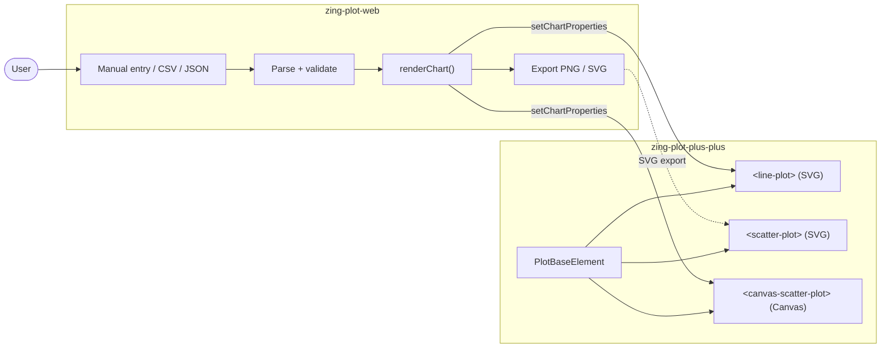

# Architecture

The repo has two parts:

- **`zing-plot-plus-plus`** is the charting library. It's a set of web components (custom HTML tags) and is published to npm as `bros-zing-plot-plus-plus`.
- **`zing-plot-web`** is a static website that uses the library. Users enter or upload data and get a line or scatter chart they can download.

The website doesn't import the library from the repo. It loads the published version from the jsDelivr CDN, the same way any other user would.

## Diagram

## The library

Every chart type extends `PlotBaseElement` in `plotBase.js`. The base class handles everything the charts have in common: the shadow DOM, axes and tick marks (`getTicks`, `computeLayout`), zoom and pan, the reset button, the tooltip (`<tool-tip-modal>`), and the `setChartProperties(...)` call that takes the data and size.

| File | What it adds |
| --- | --- |
| `plotBase.js` | `PlotBaseElement` and `<tool-tip-modal>` |
| `detailedPlots.js` | `<line-plot>` and `<scatter-plot>`. They only override `applyPlotElements()` to draw the line or the points as SVG. |
| `canvasScatterPlot.js` | `<canvas-scatter-plot>`, which draws the whole chart onto a single `<canvas>` |
| `canvasPoints.js` | Helpers for the canvas chart: `drawPoints()` and `findPointAt()` (finds the point under the mouse for the tooltip) |

## The website

Everything runs in `script.js`, with no framework or build step. When the user enters data or drops a file, `parseCSV()` / `parseJSON()` and `toNumber()` / `validate()` turn it into numbers or show an error message. If the file has several numeric columns, the user picks which ones are X and Y. `renderChart()` then creates a `<line-plot>` or a `<canvas-scatter-plot>`, calls `setChartProperties(...)`, and puts the chart on the page.

Save opens an export preview. For PNG, the app draws the chart at the chosen size. For SVG, it renders the same data with the SVG components (`<line-plot>` or `<scatter-plot>`) and saves that markup. That's why `<scatter-plot>` is still around even though the site shows the canvas version.

